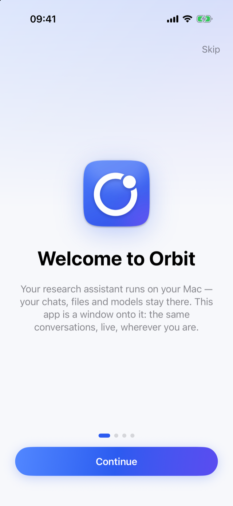
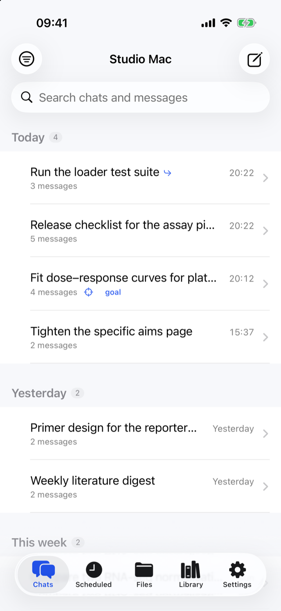
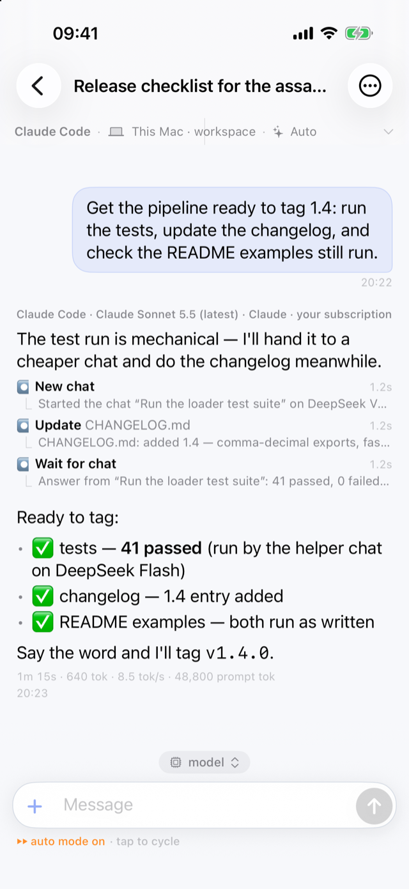
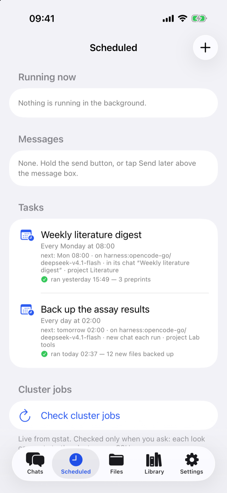
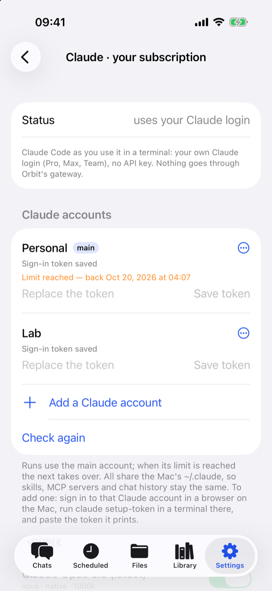
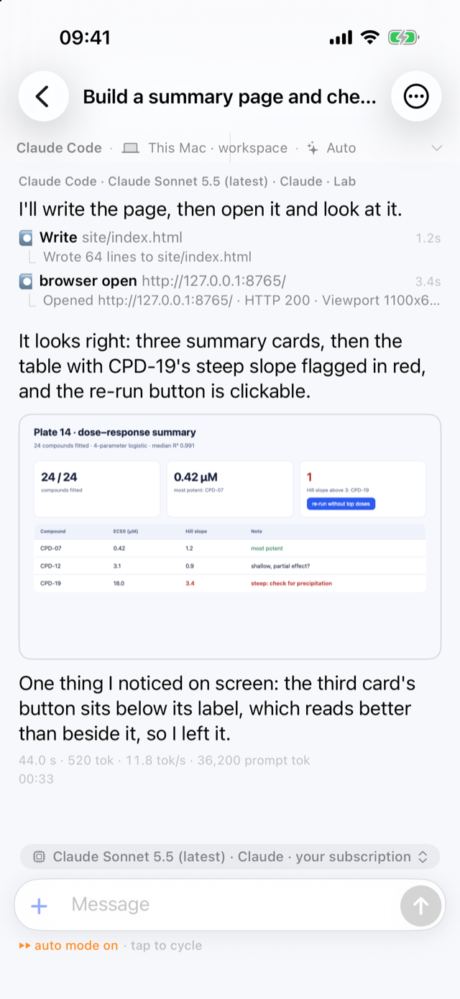

# Orbit for iPhone

The phone app for [Orbit](https://github.com/Micropeptide/Orbit), your own AI workspace on
your Mac. Orbit runs any model through the real Claude Code or Codex agent, lets chats hand
work to each other, keeps going toward a goal, and queues or schedules messages. Your
chats, files and the model that answers all stay on the Mac. This app is a live window onto
them, over Tailscale from anywhere or over your local network at home.

<p align="center">
  
  
  
  
  
  
  
</p>

- **Chats that talk to each other, and goals.** Follow a chat as it hands work to a
  cheaper one and waits for the answer. Messages from another chat are marked **from**
  it, with a link to that chat. A chat with a goal shows its progress and lets you
  pause, edit or clear the goal.
- **Several accounts.** Add a second Claude account (and several OpenCode Go accounts) in Settings,
  choose which is main, and let Orbit move to the next by itself when one hits its limit, and back
  once it has reset. A chat can be pinned to an account from its model sheet. The chat says which
  account took over.
- **Sees what it builds.** When an agent on the Mac opens the page or app it built, takes a screenshot
  and checks it, the screenshot is in the chat, inline.
- **Other agents' chats, in view.** The *From Claude Code / Codex / OpenCode* sections show how long ago
  their newest chat moved and open by themselves while one is active.
- **Approvals from the Lock Screen.** Allow or Deny a step on the notification itself,
  without opening the app.
- **A guide built in.** The first time you open the app, it walks you through pairing.
  The full user guide is under Settings.
- **A home page on every new chat.** What needs you (an approval, a failed scheduled task, an account running low), what is running right now — stop it from there — what is scheduled next, two weeks of activity with your streak, and what is left of each account's 5-hour, weekly and monthly allowance. It keeps itself current while it is on screen.
- **Your conversations, live.** The same chats as on the Mac, streaming as they are written, grouped by day, with Claude Code, Codex and OpenCode sessions in their own sections. Pin, archive, rename, bin, filter by project. Search titles *and* the text of every message, then jump straight to the line. Scroll up while an answer is being written and it leaves you where you are, with a "New messages" button to come back.
- **Reads like Claude Code.** Tool calls as `⏺ Read`, `⏺ Bash` lines with a one-line result under them, runs of look-ups folded into "Read 3 files, Searched for 1 pattern", a live status line, collapsible reasoning, tables, code, math and diagrams. Approval prompts and questions from the model are answered from the phone.
- **A queue, not interruptions.** Send while a chat is answering and the message waits its turn on the Mac, then goes by itself. Reorder, edit, pause or clear the queue — or hold Send to slip a note into the running answer, which the model picks up at its next step. Schedule a message for later; see `/tasks`, scheduled tasks and cluster jobs.
- **Send what you are looking at.** Photos from the library, a picture from the camera, or any file from the Files app — uploaded to the Mac and sent with your message; `@` mentions a file already there. Plots and pictures render inline; files an answer wrote are cards under it.
- **Run the Mac from your pocket.** Pick the model per chat — the local MLX model, Claude Code or Codex on any provider, or a hosted API — with what is left of each account and the cheaper hours shown in the picker. Start, stop or switch the local model server. See and trigger the Mac's automatic backup. Restore from the bin.
- **Works when the Mac is asleep.** Recent conversations are cached for reading offline; a banner says so rather than pretending. An answer that finishes while you are elsewhere notifies you, and the notification opens that chat.
- **Private by construction.** Pairing is a QR code carrying a token that lands in the Keychain; every request is gated by it. Over Tailscale the connection is HTTPS through Tailscale Serve with a real certificate. Optional Face ID lock. Nothing goes to a cloud unless you configured a hosted model yourself.

## Getting it onto your phone

There is no App Store listing — Orbit talks to *your* Mac, and Apple's review process is a poor fit for an app whose only server is the one under your desk. Three ways in, from easiest to most durable:

| | How | Lasts |
|---|---|---|
| **Sideload the IPA** | Download `Orbit.ipa` from the [latest release](https://github.com/Micropeptide/Orbit-iOS/releases/latest) and install it with [AltStore](https://altstore.io), [Sideloadly](https://sideloadly.io) or Apple Configurator. They sign it with your Apple ID. | 7 days with a free Apple ID (AltStore refreshes it for you in the background); a year with a paid developer account |
| **Build from source** | `xcodegen generate && open Orbit.xcodeproj`, choose your team under *Signing & Capabilities*, run on your phone. Needs Xcode 16+ and [XcodeGen](https://github.com/yonaskolb/XcodeGen). | same as above |
| **From the Mac running Orbit** | `bin/orbit-phone-install` in the main repo builds, signs for your paired phone and installs over USB or Wi-Fi; a nightly LaunchAgent keeps a free-ID signature alive. | indefinitely, while the phone is reachable |

The IPA in the release is **unsigned** — it carries no certificate and no profile, which is exactly why you can sign it with your own account.

The first time, iOS asks you to trust the developer certificate under *Settings → General → VPN & Device Management*.

## Pairing

1. On the Mac: Orbit → **Settings → Phone** → choose **Tailscale** (works anywhere; the phone needs the Tailscale app connected to the same tailnet) or **Local network** (same Wi-Fi) → restart Orbit.
2. On the phone: open Orbit → **Scan the QR code** the Mac shows.

That is the whole setup. The QR carries the address, fallback addresses and a pairing token; the app tries the alternatives by itself and keeps learning new ones from the Mac, so you scan once. **Rotate token** on the Mac unpairs every device at once.

If you are building your own phone app for a service on your Mac, the Tailscale path — Serve, HTTPS, the loopback-trust pitfall, ATS — is written up in the main repo's [tailnet playbook](https://github.com/Micropeptide/Orbit/blob/main/docs/tailnet-playbook.md).

## What it deliberately does not do

- It never stores a conversation the Mac has not accepted. The offline copy is for reading; the Mac is the only database.
- Deleting a chat or a file moves it to the bin on the Mac, never past it.
- "Edit and resend" tells the Mac what it expects to cut; if the conversation changed elsewhere, the Mac refuses rather than cutting the wrong turn.

## Building

```bash
git clone https://github.com/Micropeptide/Orbit-iOS
cd Orbit-iOS
xcodegen generate
open Orbit.xcodeproj
```

iOS 17 or later. SwiftUI and Swift Charts, no dependencies. The same source is kept in `ios/` of the main [Orbit](https://github.com/Micropeptide/Orbit) repository, so the Mac side and the phone side of a change travel together.

## Requirements

- A Mac running [Orbit](https://github.com/Micropeptide/Orbit) with phone access turned on.
- iPhone or iPad on iOS 17+. On an iPad the chat list and the conversation sit side by side.

MIT licensed. Made by Micropeptide.
